# 墨线小镇 · Inkline Town

**一款以墨线绘制、按任期推进的城镇经营游戏。** 你担任市长，每届任期为 45、60 或 90 分钟；只要城镇仍在运转，就可以继续连任。铺设道路，安置移民，建立食物和衣物生产链，让聚落逐步发展为村庄、城镇，最终成为富裕市民居住的城市。经营不善，也可能走向破产、叛乱或废弃。

<p align="center"><a href="https://inkline.typeonce.dev"><b>▶ 在浏览器中游玩墨线小镇</b></a> · 免费，无需安装，存档保存在本机</p>

<a href="docs/media/inkline-town.mp4">
  <picture>
    <source srcset="docs/media/inkline-town.avif" type="image/avif">
    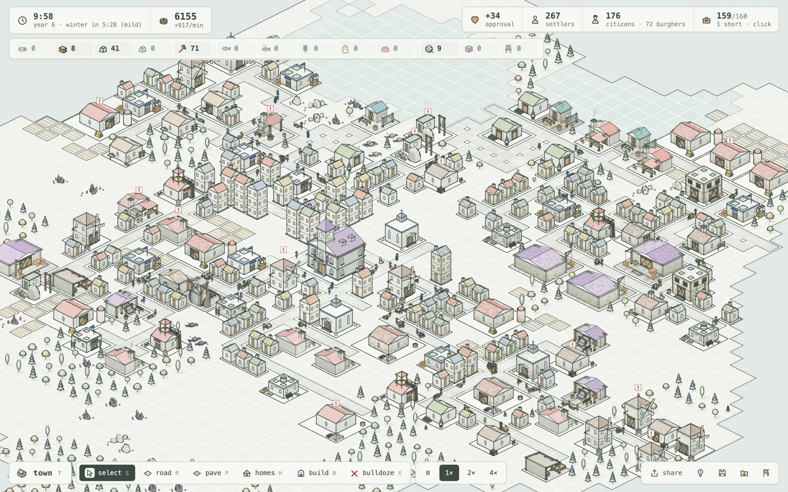
  </picture>
</a>

<p align="center"><sub>建设八十分钟的小镇，以两倍速运行的三十秒片段。 <a href="docs/media/inkline-town.mp4">观看原画质视频</a>.</sub></p>

墨线小镇像一款小巧的《纪元》式经营游戏。建筑、车辆与人物都以细线条 3D 模型实时绘制。你可以平移、缩放、旋转岛屿；每张地图都不同，每届任期结束时都会给出评价，并记录这座城镇的故事。

## 新的建城章程，新的土地

每座城镇都从一份建城章程开始。你决定地图大小，森林、石料、矿石和湖泊的丰度，以及任期长度。不同种子生成不同岛屿，海岸曲折，岬角向外延伸。

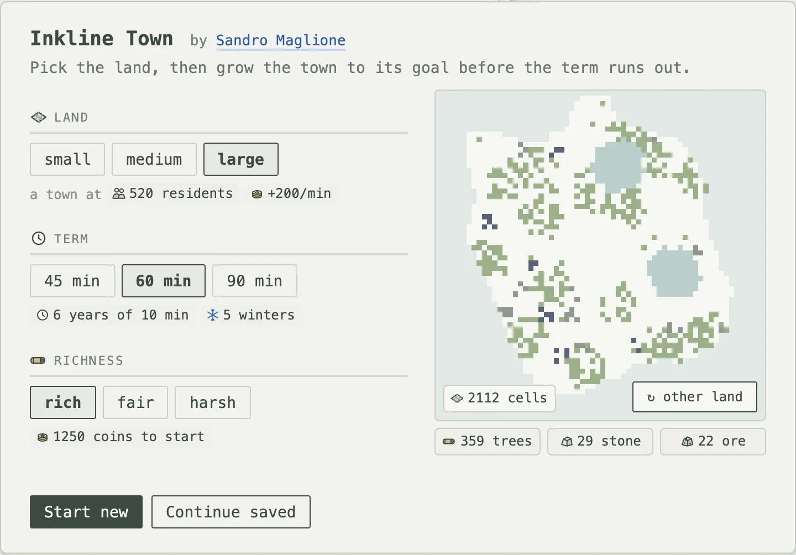

<table>
  <tr>
    <td>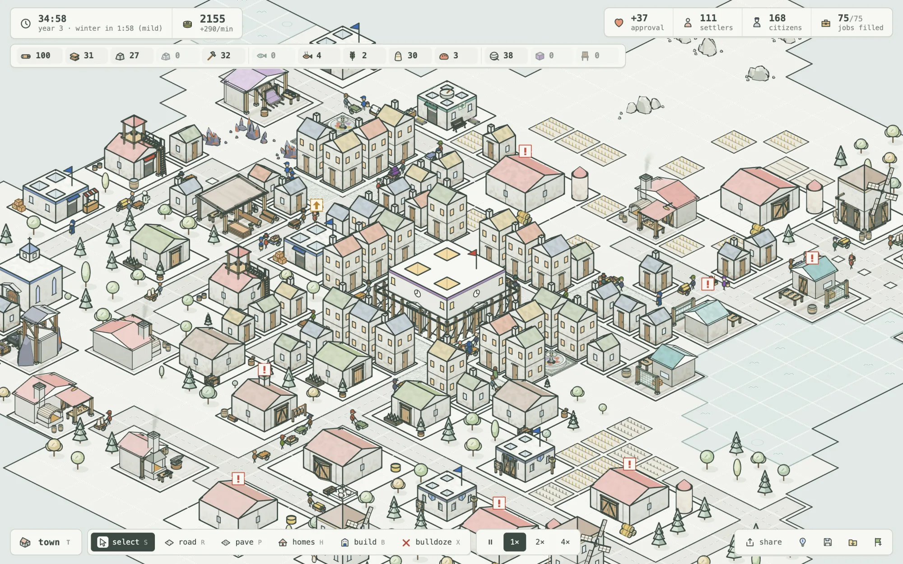</td>
    <td>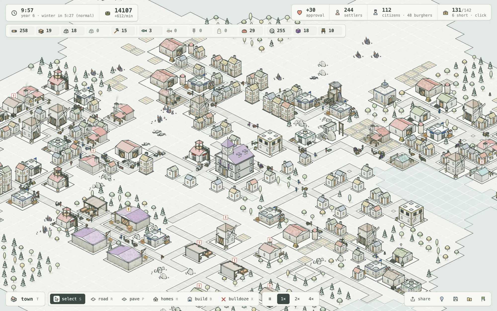</td>
  </tr>
  <tr>
    <td align="center"><sub>小型地图，建设二十五分钟：宅邸围绕喷泉，市政厅正在升级</sub></td>
    <td align="center"><sub>大型地图，建设八十分钟：三百五十位居民分布在岛屿各处</sub></td>
  </tr>
</table>

## 建立生产链，看城镇运转

伐木场获取原木，锯木厂加工木板；采石场与矿场提供石料和矿石，铁匠铺锻造工具。农场的小麦送往磨坊与面包坊，牧羊场的羊毛送往织布坊，木工坊用木板制作市民宅邸所需的家具，渔场则供应初期食物。运输员推着装满货物的车沿路搬运，市场配送员提篮走过街区，向住宅送去食物、布料与家具。

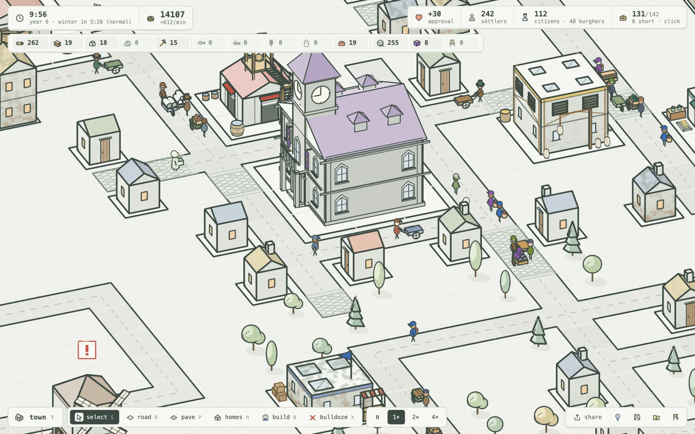

移民需要食物。住宅获得面包、布料与教堂提供的信仰服务，街区宜居度达标，并支付重建费用后，小屋便会升级为两层市民住宅，容量翻倍，人均基础税额也翻倍。市民身穿长外套、头戴高顶帽，每个家庭的衣服颜色与自家屋顶呼应。

## 像真实城镇一样布局和运转

每条街都有宜居度。铁匠铺和采石场会影响周围数格；你亲手布置的草坪、花坛、小径、路灯、喷泉和雕像，以及教堂与石铺道路，则会改善环境。市民只愿入住宜居街区；最好的街区获得全部公共服务，并持续供应家具后，便能发展出三层市民宅邸。

移民负责基础劳动，市民负责技术工作。居民最多步行十五格道路上班，因此远处矿场也需要附近的工人小屋。合理分区后，城镇会形成优美的中心、边缘工业区与磨坊旁的住宅。

还要维护城镇。消防站、医馆和治安所派出人员降低火灾、疾病与盗窃风险。灾害发生前，住宅上方就会出现预警；发生火灾时，消防员赶赴现场。鲜鱼和面包会腐坏，粮仓能延长保鲜时间；工具会损耗，修缮工坊负责维修建筑。每年的冬季可能是暖冬、普通冬季或严冬，年历会提前一年预报。地图视图可显示宜居度、劳动力、火灾、健康、治安和建筑状况。

## 在压力下执政

城镇越大，负担越重。冬季农田停产，捕鱼量减少；每位居民带来的行政开支也随总人口增长。渔场还需分散到不同水域，避免争抢尚未恢复的鱼群。物资卖得越多，贸易价格越低。王室限时索要物资，逾期会留下不良记录。支持度决定每栋住宅能容纳多少人。

你可以调整移民与市民税率、各类物资的买卖与保留量，暂停建筑工作，并决定何时交付王室要求的物资。

<table>
  <tr>
    <td>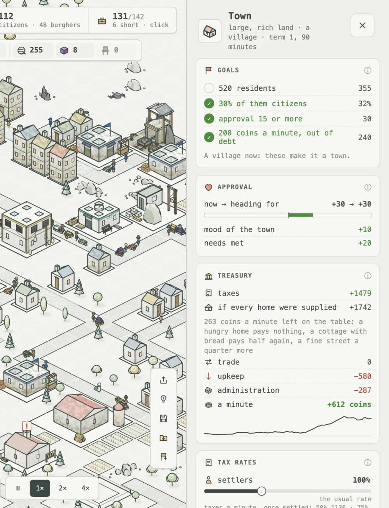</td>
    <td>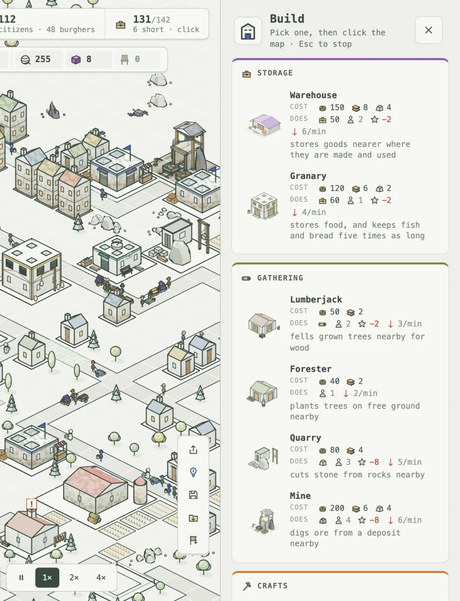</td>
  </tr>
  <tr>
    <td align="center"><sub>城镇面板：目标、支持度、财政、税率和贸易</sub></td>
    <td align="center"><sub>建造菜单随城镇发展逐步解锁</sub></td>
  </tr>
</table>

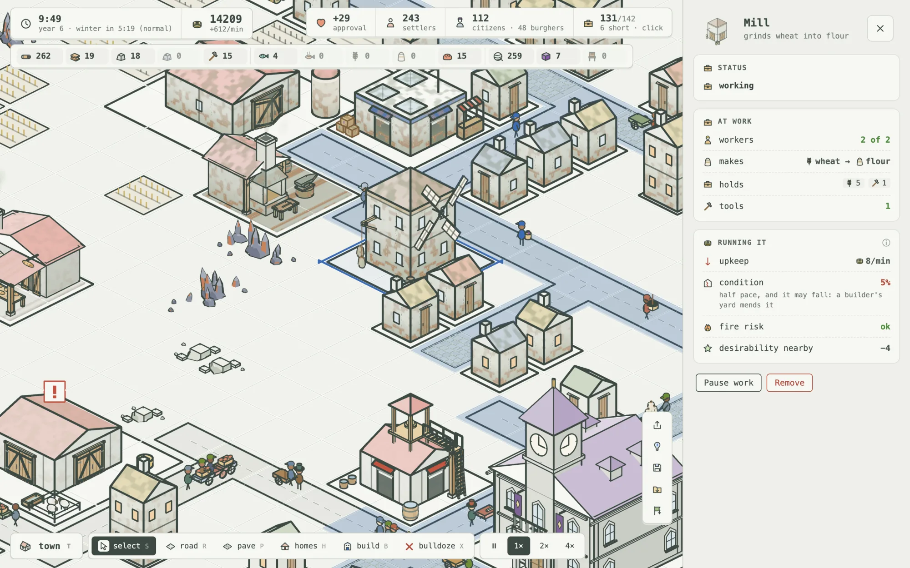

## 任期结束，城镇延续

小镇从**聚落**起步，同时满足下一级的人口、每分钟净收入、市民占比与支持度目标，并保持无负债两分钟后，可晋升为**村庄**、**城镇**，最终成为**城市**；城市还要求富裕市民和行会大厅。晋升看经营收入，无需囤积金币，每次晋升都有王室奖励。等级也会解锁原地升级：市政厅变成行会大厅，再到城市政厅；市场升级为市场大厅，面包坊升级为烘焙工坊，采石场升级为石工作坊。运输员送来建材，脚手架逐渐搭起，原建筑在此期间仍会工作。达到新等级后，任期继续。

连续负债三分钟、持续骚乱两分钟、居民大量离开，或连续三次未满足王室要求，都会使任期**失败**。否则，任期结束时会根据发展状况给出评价。选择**下一任期**可保留城镇继续执政，也可卸任并新建城镇。石料与矿石采尽后会留下缓慢产出资源的采空矿面，既可继续开采，也可清理后建造。

结算页面展示整个任期的人口、金币与支持度曲线，冬季以阴影标出，下方列出大事记。

<p align="center">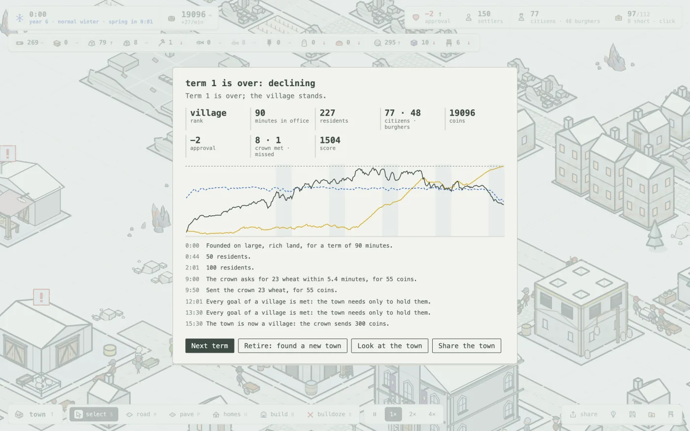</p>

## 用墨线绘制

游戏中的图形由代码绘制，在浅色底面上使用两种线宽，无需角色贴图。建筑用其产品的颜色作点缀，院落中保留工作痕迹：原木堆、粮仓、羊圈或条纹市场棚。树木、岩石、水域与道路在不同格子上各有变化。

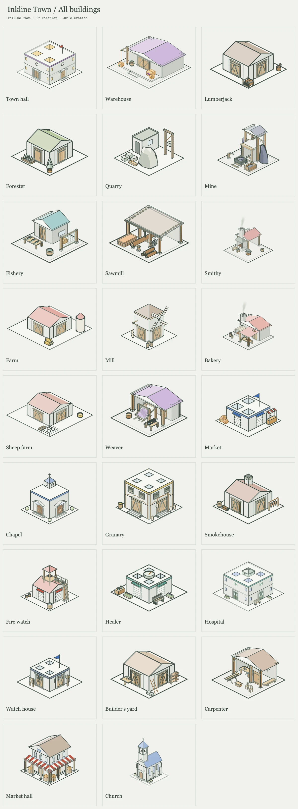

随着城镇晋升，建筑也逐步升级。市政厅先成为带钟楼与旗帜的行会大厅，再成为配有穹顶和立柱的城市政厅。升级中的建筑周围搭起脚手架，随着货车送来建材，工作平台和梯子逐步填满。

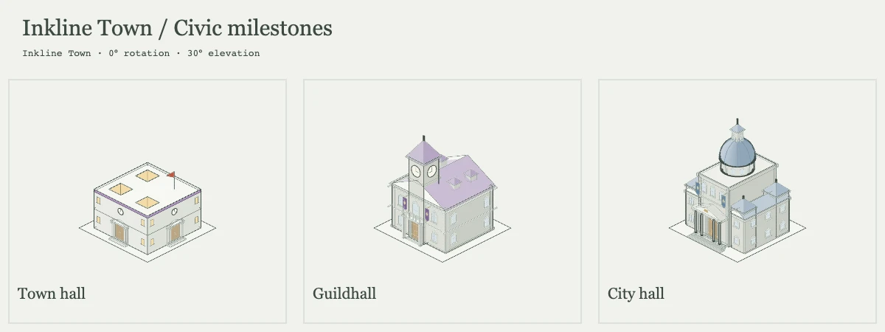

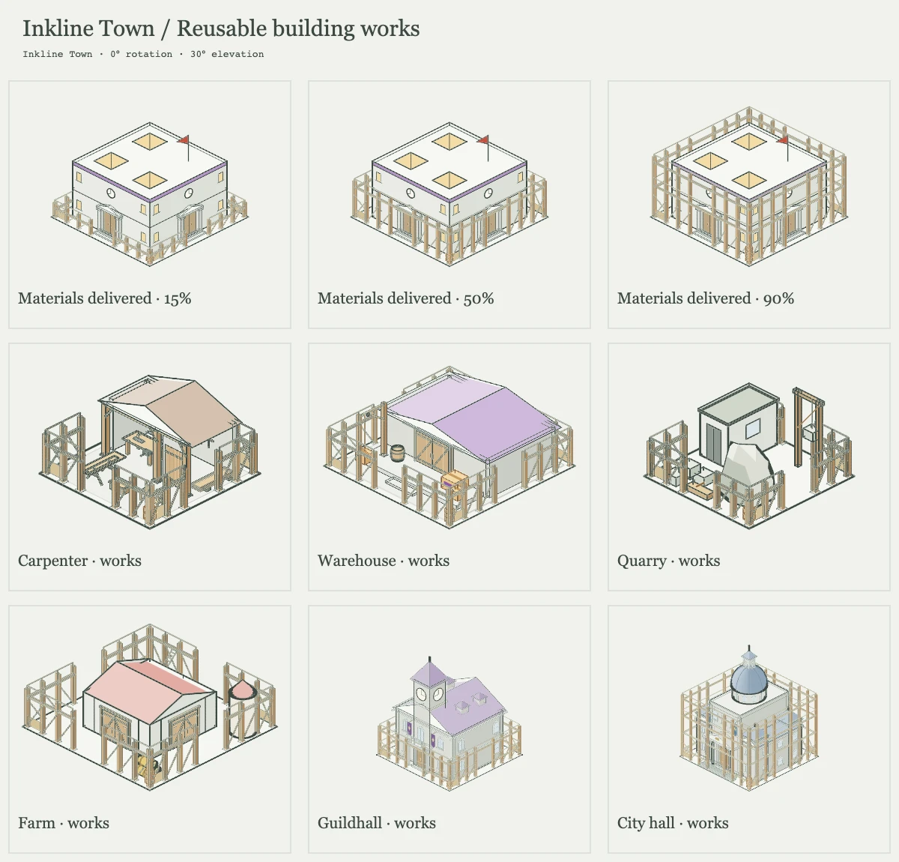

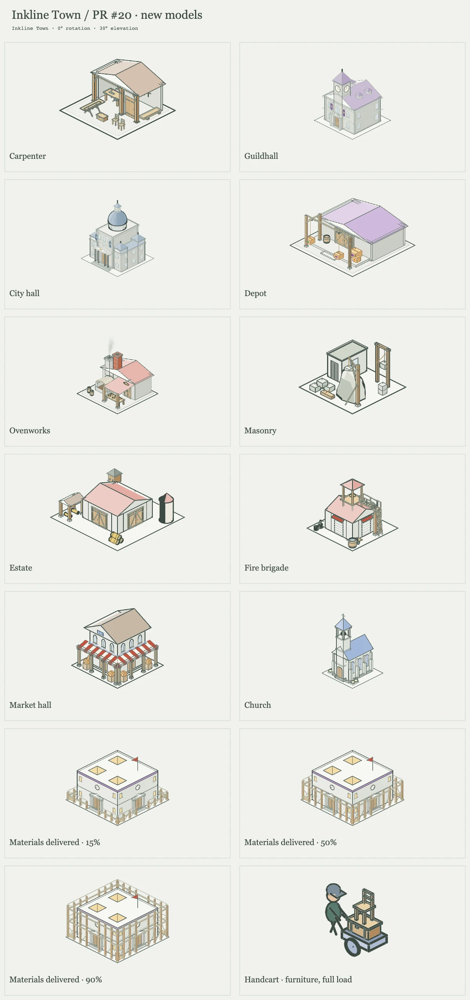

## 开始游戏

**[在 inkline.typeonce.dev 游玩墨线小镇](https://inkline.typeonce.dev)。**
支持电脑和手机浏览器，存档保存在当前浏览器内，每两分钟游戏时间自动保存一次。可以分享城镇图片，或生成链接，让他人查看城镇运行并接手继续游玩。

初次游玩可阅读[玩法指南](docs/how-to-play.md)，了解操作、任期规则与城镇运作方式。本地运行：

```sh
pnpm install
pnpm dev
```

---

[玩法指南](docs/how-to-play.md) · [开发说明（英文）](DEVELOPMENT.md) · [任期设计（英文）](docs/mayor-plan.md)
